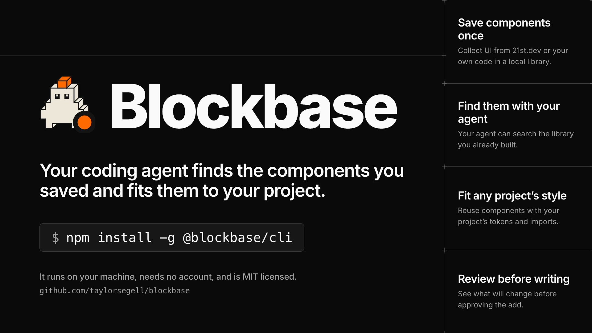
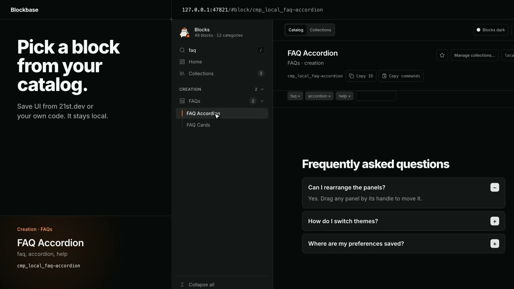
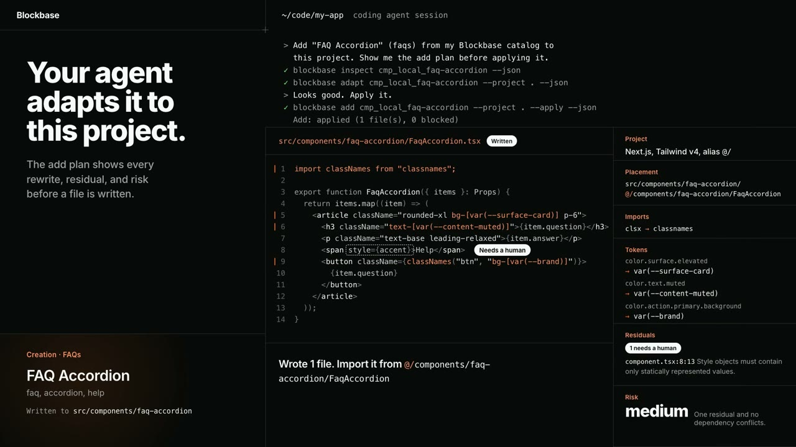

# Blockbase



https://github.com/user-attachments/assets/033b4e60-4042-44eb-895a-bb5655f293dc

Blockbase is a local catalog and adaptation engine for UI components. Import a component once and Blockbase keeps its original source immutable, indexes it for search, and normalizes its styling into a framework-neutral token contract. When you need it in another project, Blockbase produces an adaptation that fits that project's own tokens and conventions, usually in one or two agent exchanges.

It runs entirely on your machine: there's no account and no cloud service. Installing the agent integration also sets up an opt-out, user-level login service that serves the catalog page on loopback; remove it any time with `blockbase ui service uninstall`.

> The CLI, MCP server, and agent integrations are tested on macOS and Linux. The catalog page (`blockbase ui`) renders catalog components locally. See [Current limitations](#current-limitations).

## What you can do with Blockbase

- **Save components once.** Collect UI from 21st.dev or your own code in a local library.
- **Find them with your coding agent.** Search the components you’ve already saved.
- **Fit them to your project.** Adapt components to your project’s tokens and imports.
- **Review changes before writing.** See the plan and approve it before Blockbase writes files.

<details>
<summary>See the catalog and an adaptation plan</summary>





</details>

## Requirements

- Node.js **24 or newer** (the search index uses the built-in `node:sqlite` module)
- pnpm 12 (the version pinned in `packageManager`)

## Install

```sh
npm install -g @blockbase/cli
blockbase agent install --provider <claude-code|codex|cursor> --scope project --project <dir>
```

In Claude Code you can skip both commands and install the plugin instead; it installs the CLI itself:

```sh
/plugin marketplace add taylorsegell/blockbase
/plugin install blockbase@blockbase
```

See [integrations/agent/PLUGIN.md](integrations/agent/PLUGIN.md). With npm, the second command installs the skill package into `<dir>`, creates the catalog at `~/.blocks` (or `BLOCKBASE_HOME`) when it is absent, and installs a login service that starts the catalog page at `http://127.0.0.1:47821/#home`. Pass `--no-setup` to install the skills only, then run `blockbase setup --json` later (`--no-service` creates the catalog without the service). The service is a launchd agent on macOS or a systemd user unit on Linux; `blockbase ui service uninstall` removes it and never touches the catalog. `blockbase ui` runs the catalog page in the foreground instead. The package needs Node 24 or newer and includes the catalog page and the agent skill files, so no clone is needed.

There is also a [VS Code extension](apps/vscode/README.md) for browsing the catalog from VS Code or Cursor.

### Install from source

For contributors:

```sh
git clone https://github.com/taylorsegell/blockbase.git
cd blockbase
pnpm install
pnpm build
pnpm add --global "$PWD/packages/cli"   # puts `blockbase` on PATH; run `pnpm setup` once first if pnpm has no global bin directory
blockbase agent install --provider <claude-code|codex|cursor> --scope project --project <dir>
```

The last step does the same setup as above.

`pnpm add --global` with a local path links the checkout rather than copying it, so a later `pnpm build` is picked up without reinstalling. You can also call `node packages/cli/dist/index.js doctor` directly without linking.

## How it works

```
import ──▶ catalog (~/.blocks) ──▶ search / inspect ──▶ adapt ──▶ add ──▶ validate
              │                                           ▲
              └── immutable, content-hashed revisions     └── project inspect (destination tokens)
```

- **Catalog.** Components live under `~/.blocks/components/<namespace>/<slug>/`, one `component.json` manifest per component plus immutable `revisions/<sha256>/` directories. Run `blockbase catalog locate` to see the active root.
- **Search index.** The SQLite FTS5 index is rebuilt from the manifests (`blockbase catalog rebuild`) and is never the source of truth.
- **Normalization.** Styling is mapped onto a semantic token contract (`color.surface.default`, `space.N`, `radius.*`, …) so a component can be re-emitted against a different design system.
- **Adaptation.** `adapt` plans the port against a destination project's real tokens (found by `project inspect`). `add` writes it, and `validate` checks the result.

## CLI

Every command supports `--json` and returns a versioned envelope. That is the stable integration contract.

| Command | Purpose |
| --- | --- |
| `blockbase import <source>` | Import a component into the catalog |
| `blockbase search <query>` | Full-text search over the catalog |
| `blockbase inspect <id-or-alias>` | Show a component's manifest, interface, and quality report |
| `blockbase project inspect --cwd <path>` | Profile a destination project's framework and tokens |
| `blockbase adapt <id>` | Plan an adaptation for a destination project |
| `blockbase add <id>` | Write the adapted component into the destination |
| `blockbase validate <adaptation-manifest>` | Check an adaptation against its manifest |
| `blockbase catalog locate \| list \| rebuild \| validate \| migrate` | Catalog maintenance |
| `blockbase theme init \| validate \| add \| derive` | Manage preview themes |
| `blockbase agent install \| update \| check \| remove \| link \| unlink` | Install the agent skill packages |
| `blockbase setup` | Create the catalog and install the catalog page login service (`--no-service` skips the service) |
| `blockbase ui` | Serve the catalog page on `127.0.0.1:47821` in the foreground (`--port`, `--allowed-host`, `--open`) |
| `blockbase ui status \| service install \| service uninstall \| service status` | Check the page, and manage the user login service |
| `blockbase doctor` | Environment and catalog health check |

### Importing a 21st.dev paste

Copy a component from 21st.dev and pipe it in with `--from 21st`:

```sh
pbpaste | blockbase import - --from 21st --json
```

Blockbase splits the paste into files without any network access. The component files become the block, the demo is installed beside it so the catalog page can show it, and the raw paste is kept as `source-paste.txt`. Packages from the install list are recorded as dependencies. The license stays `unknown` unless you pass `--license`. shadcn pieces the paste imports but does not include are reported as warnings, not fetched. A messy paste still imports. Blockbase looks past stray characters to find where each file starts, never changes the code, and reports anything that looks damaged as a warning. Use `blockbase inbox add - --from 21st` to park a paste for later.

## Agent integrations

Blockbase ships skill packages for **Claude Code**, **Codex** and **Cursor**, generated from one canonical spec in `integrations/agent/`. Install them into a project or globally:

```sh
blockbase agent install --provider claude-code --scope project --project <dir>
```

The capture skill recognizes a 21st.dev paste on its own, asks for the name, page URL and license when they are missing, and reports the demo rewrites and warnings. An optional MCP server (`packages/mcp`) exposes the same operations to MCP-capable clients. See [docs/architecture/plugin-installation.md](docs/architecture/plugin-installation.md).

## Repository layout

```
packages/contracts   JSON contracts, schemas, CLI envelope types
packages/core        catalog, import, search index, normalization, themes, adaptation, preview policy
packages/cli         the `blockbase` command
packages/mcp         optional MCP server over the same core
apps/preview         loopback catalog page (Vite dev server)
integrations/agent   canonical agent spec and generated provider packages
tests/fixtures       synthetic catalogs and destination projects used by the test suite
```

## Development

```sh
pnpm test             # full suite
pnpm typecheck
pnpm run drift:check  # generated agent packages match their canonical spec
pnpm run benchmark    # search latency at 10,000 entries
```

## Current limitations

These are untested or out of scope for this release. Don't rely on them:

- Windows installation or Windows filesystem behavior.
- A hosted or networked preview. The catalog page renders catalog components in a local Vite dev server bound to loopback; there is no tailnet or cloud profile, and its package allowlist is limited to React.
- Live model runs in Claude Code, Codex, or Cursor. The agent tests replay fixed, recorded exchanges.
- Frameworks other than React, and adapters outside the supported React handoff subset.
- Vector search and hosted or cloud installation.
- Installs against the live npm registry or a live Claude Code marketplace session. `pnpm run pack:smoke` installs the packed tarballs offline and `claude plugin validate` checks the plugin, but neither path has been run end to end against the real services.

## Contributing

See [CONTRIBUTING.md](CONTRIBUTING.md) for setup and the checks to run before a pull request, and [CODE_OF_CONDUCT.md](CODE_OF_CONDUCT.md).

## Security

Importing a component never executes its code or its dependency install scripts. See [SECURITY.md](SECURITY.md) for how to report a vulnerability.

## License

[MIT](LICENSE). The license covers Blockbase itself. Components you import keep their original licenses, and Blockbase records their provenance but cannot grant you rights to them.
